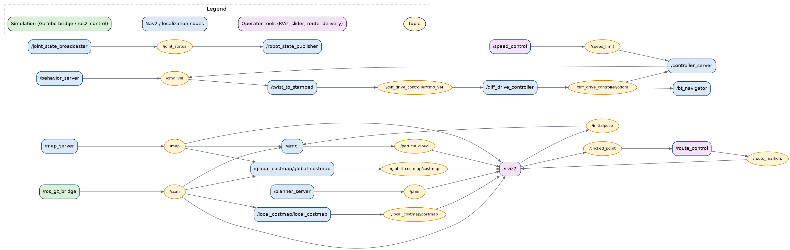

# Delivery Robot: ROS 2 and Gazebo Simulation

A 4-wheel skid-steer delivery robot that maps a simulated warehouse, localizes itself, navigates between rooms and carries out delivery missions. Everything runs in simulation (Gazebo) on ROS 2 Jazzy.

| Front | Rear |
|---|---|
|  |  |

## Demo

Overhead view of a full delivery in the simulated warehouse: dock, room 1, room 2, back to the dock (2x speed).


Full-size video: [docs/delivery_demo.mp4](docs/delivery_demo.mp4) (H.264; download it if your browser or player does not open it).

## Features

- **SLAM mapping** with SLAM Toolbox, driven by hand (teleop) or automatically.
- **Automatic exploration** (`nav2_exploration`): finds frontiers in the map and drives to them with Nav2, including into the two rooms through ~0.9 m doorways.
- **Localization** on the saved map with AMCL, and **navigation** with Nav2 (Regulated Pure Pursuit controller, NavFn planner) tuned for tight spaces.
- **Odometry calibration** for the skid-steer base: `wheel_separation_multiplier: 1.28` corrects a ~28% yaw over-report caused by wheel slip, which otherwise makes SLAM drift and produce ghost maps.
- **Visual SLAM** (RTAB-Map, RGB-D camera only) next to LiDAR SLAM, with a measured comparison against Gazebo ground truth.
- **Multi-stop deliveries** (`deliver`): visit named places in order, wait for confirmation at each, skip unreachable stops, return to the dock.
- **IMU**: a simulated IMU (`/imu`, 100 Hz, gyro and accelerometer with noise) is on the robot. Nothing uses it yet.
- **Operator tools**: a Delivery button window, a speed-limit slider, and a route tool to click several stops in RViz.
- **One-command bringup** that starts the whole system in order and waits for each stage to be ready.

## Maps

The warehouse map built by the automatic exploration node (235 x 195 cells, about 11.8 x 9.8 m):


## System overview

Nodes and topics of the running system (generated from the live ROS graph by `docs/make_ros_graph.py`; `/tf`, `/clock`, lifecycle and action topics are hidden for readability):



## LiDAR SLAM vs visual SLAM

Both ran on the same drive (dock, room 1, room 2, dock; 21.6 m) and were scored against Gazebo's ground-truth pose:

| Source | Mean error (m) | RMSE (m) | Max error (m) | Final error (m) |
|---|---|---|---|---|
| Wheel odometry only | 0.60 | 0.68 | 1.29 | 1.29 |
| LiDAR SLAM (slam_toolbox) | 0.05 | 0.07 | 0.21 | 0.01 |
| Visual SLAM (RTAB-Map, camera only) | 0.17 | 0.21 | 0.40 | 0.31 |


- LiDAR SLAM is the most accurate and produces a complete, clean 2D map (RMSE 0.05-0.07 m in every run). It is also the repeatable one.
- The wheel odometry alone drifts by more than a metre over this route even after calibration.
- **Visual SLAM is not reliable in this setup.** The 0.21 m result above is from the best run I had. Later repeats on the same feature-rich world gave an RMSE of 2.3 m and 2.7 m (with and without the chair legs, so the legs are not the cause), and the visual odometry reported "lost" for roughly half of the frames. On the realistic brick, plaster and concrete world it was worse (1.2 to 4.0 m). Treat 0.21 m as a best case, not a typical result.
- Things I tried afterwards on the feature-rich world (one run each): SIFT features instead of the default (`feature_type:=1`) gave an RMSE of 1.3 m with tracking lost in about 37% of the frames, which is better than the default but still poor; SIFT plus the wheel-odometry hint (`guess_frame_id:=odom`) gave 2.0 m. RTAB-Map's odometry only uses an IMU to set its initial orientation, so the IMU did not help; fusing it with the wheels (an EKF) is still open.
- It needs a scene with lots of distinct detail. For the experiments there is a separate feature-rich test world with random colour patterns (`world:=delivery_warehouse_vslam.world`, textures in `worlds/textures_vslam/`). It is not meant to look real. The default world (`delivery_warehouse.world`) has realistic brick walls, painted plaster room walls and a concrete floor (`tools/make_world_textures.py`).
- Caveats: only a handful of runs, in simulation, noise-free camera streams. Camera-only visual odometry could probably be made steadier with a wheel-odometry or IMU motion hint, better tuning, or a better camera setup; I did not get that working.

Live side-by-side view while the robot drives (camera, LiDAR map with its path, visual map with its path; the visual panel says when tracking is lost and how often):


```bash
ros2 run delivery_robot_navigation slam_compare_view     # needs the simulation, LiDAR SLAM and visual_slam.launch.py running; q or Esc closes it
```

Reproduce it (simulation, Nav2 and LiDAR SLAM running with `bringup.launch.py mode:=slam`):

```bash
# start the simulation with: ... bringup.launch.py mode:=slam world:=delivery_warehouse_vslam.world
ros2 launch delivery_robot_navigation visual_slam.launch.py        # camera-only visual SLAM (/vo, /vslam/map)
python3 tools/slam_compare_logger.py --out run/poses.json --stop-file run/stop.flag &
ros2 run delivery_robot_controller deliver room1 room2 --wait 3 --ros-args -p use_sim_time:=true
touch run/stop.flag      # then save both maps with map_saver_cli (-t /map and -t /vslam/map)
python3 tools/slam_compare_report.py run docs/slam_comparison
```

`visual_slam.launch.py guess_frame_id:=odom` also feeds the wheel odometry to the visual odometry as a motion hint.

## Packages

| Package | Purpose |
|---|---|
| `delivery_robot_description` | URDF/Xacro model (robot, lidar, camera, `ros2_control`) and controller config |
| `delivery_robot_gazebo` | Warehouse world, sensor bridges, Gazebo launch files |
| `delivery_robot_teleop` | Keyboard teleop and the `Twist` to `TwistStamped` converter |
| `delivery_robot_navigation` | LiDAR and visual SLAM, localization, Nav2 config and launch files, RViz view, speed slider, route tool, saved map |
| `delivery_robot_exploration` | `nav2_exploration` (frontier exploration with Nav2) and the older reactive `autonomous_exploration` |
| `delivery_robot_controller` | `deliver` mission command, `delivery_panel` window, named locations |
| `delivery_robot_bringup` | `bringup.launch.py`, the one-command launch |
| `delivery_robot_perception` | Empty for now (planned) |

## Requirements

- Ubuntu 24.04 with ROS 2 Jazzy and Gazebo (`gz sim`)
- ROS packages: Nav2 (`nav2_bringup` and the planner, controller, AMCL, map server and waypoint follower packages), `slam_toolbox`, `rtabmap_ros` (`ros-jazzy-rtabmap-ros`), `ros_gz_sim`, `ros_gz_bridge`, `gz_ros2_control`, `ros2_controllers`, `teleop_twist_keyboard`, `rviz2`
- `python3-tk` (slider and delivery windows), `xterm` (keyboard teleop terminal), `python3-numpy`

## Build

```bash
cd ~/delivery_robot_ws
source /opt/ros/jazzy/setup.bash
colcon build --symlink-install
source install/setup.bash

# The Gazebo launch file reads the controller settings from ~/controllers.yaml
cp src/delivery_robot_description/config/controllers.yaml ~/controllers.yaml
```

## Run

Start everything (Gazebo, localization on the saved map, Nav2, RViz, speed slider, route window, Delivery window):

```bash
ros2 launch delivery_robot_bringup bringup.launch.py
```

Useful arguments: `mode:=slam` (build a new map instead of using the saved one), `world:=delivery_warehouse_vslam.world` (feature-rich test world for visual SLAM), `rviz:=false`, `speed_slider:=false`, `route_control:=false`, `delivery_panel:=false`, `teleop:=true`.

### Deliveries

- **Delivery window:** click the stops you want (in order), press **Deliver**, then press **Delivered** at each stop once the cargo has been taken. **Cancel** stops the robot.
- **Command line:**

  ```bash
  ros2 run delivery_robot_controller deliver room1 room2 --confirm
  ros2 run delivery_robot_controller deliver --list
  ```

  `--confirm` waits at each stop for Enter or the service `/delivery/confirm`; without it the robot waits `--wait N` seconds. Places are defined in `src/delivery_robot_controller/config/locations.yaml`.

### Clicking several stops in RViz

Pick the **Publish Point** tool once and click stops on the map. Numbered markers appear. Press **Go** in the Route window to drive them in order. **Undo**, **Clear** and **Cancel** are in the same window.

### Mapping

```bash
# Automatic mapping (simulation and SLAM running)
ros2 launch delivery_robot_bringup bringup.launch.py mode:=slam
ros2 run delivery_robot_exploration nav2_exploration --ros-args \
  -p use_sim_time:=true -p map_save_path:=/path/to/my_map
```

Manual mapping works with `teleop:=true`; save the result with `nav2_map_server`'s `map_saver_cli`.

## Status and limitations

- Everything has been tested in simulation only, not on a real robot.
- Mouse clicking in RViz and the layout of the Delivery window are tested by scripted messages and button logic, with limited testing by hand.
- The speed limit affects forward speed only.
- Goals very close to racks can start inside inflated space and need recovery behaviours; "collision ahead" warnings are common in the doorways.
- `gazebo.launch.py` reads `~/controllers.yaml` (see Build). If you edit `controllers.yaml` in the package, copy it there again.

## Roadmap

- Camera-based cargo detection (perception package)
- Order queue, battery and docking
- Automatic slowing near doorways
- Automated launch tests
- A real-robot version
