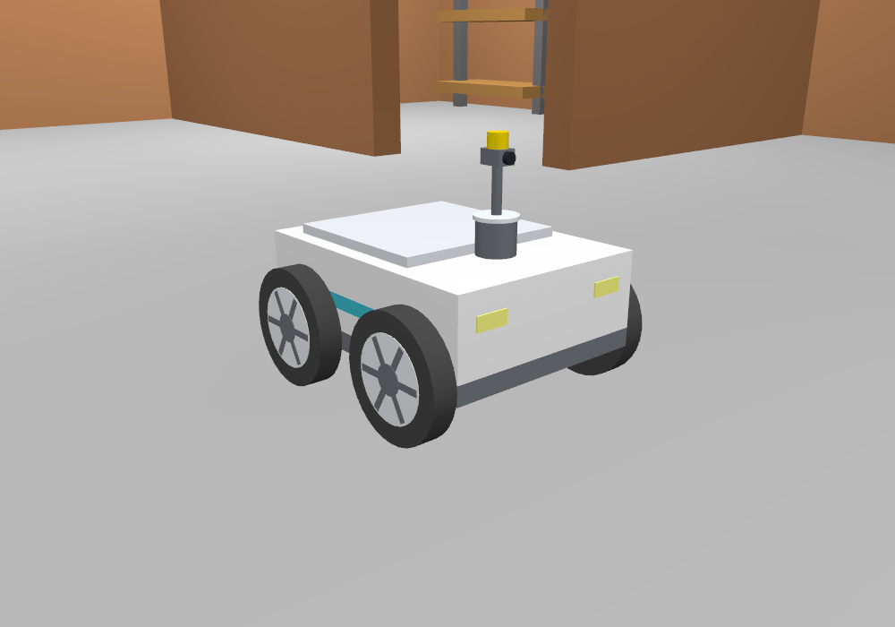
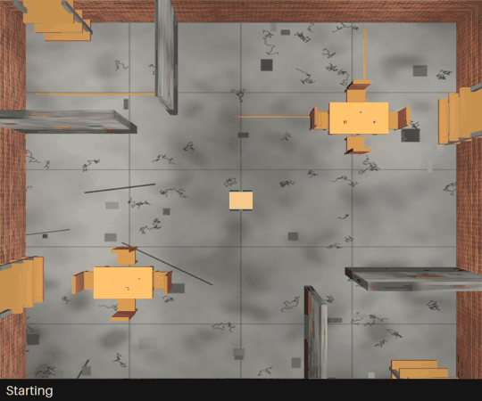
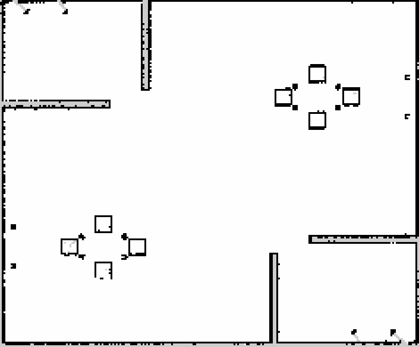
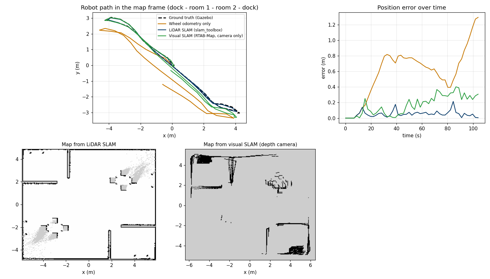
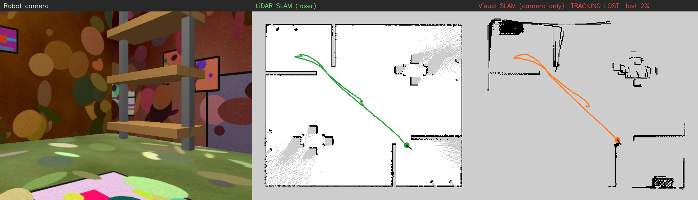
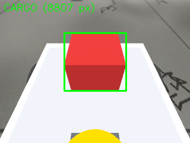
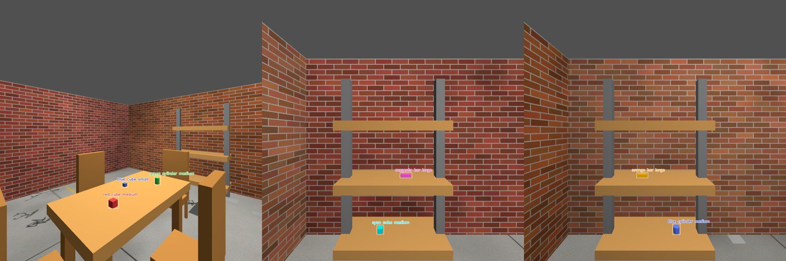

# Delivery Robot: ROS 2 and Gazebo Simulation

A 4-wheel skid-steer delivery robot that maps a simulated warehouse, localizes itself, navigates between rooms and carries out delivery missions. Everything runs in simulation (Gazebo) on ROS 2 Jazzy.

| Front | Rear |
|---|---|
|  |  |

## Demo

Overhead view of a full delivery in the simulated warehouse: dock, room 1, room 2, back to the dock (2x speed).



Full-size video: [docs/delivery_demo.mp4](docs/delivery_demo.mp4) (H.264; download it if your browser or player does not open it).

## Features

- **SLAM mapping** with SLAM Toolbox, driven by hand (teleop) or automatically.
- **Automatic exploration** (`nav2_exploration`): finds frontiers in the map and drives to them with Nav2, including into the two rooms through ~0.9 m doorways.
- **Localization** on the saved map with AMCL, and **navigation** with Nav2 (Regulated Pure Pursuit controller, NavFn planner) tuned for tight spaces.
- **Odometry calibration** for the skid-steer base: `wheel_separation_multiplier: 1.28` corrects a ~28% yaw over-report caused by wheel slip, which otherwise makes SLAM drift and produce ghost maps.
- **Visual SLAM** (RTAB-Map, RGB-D camera only) next to LiDAR SLAM, with a measured comparison against Gazebo ground truth.
- **Multi-stop deliveries** (`deliver`): visit named places in order, wait for confirmation at each, skip unreachable stops, return to the dock.
- **Block perception**: ten blocks of different colours, shapes (cube, bar, cylinder) and sizes sit on two tables and two racks. A camera on a mast finds them, names their colour, shape and size, and gives their position on the map and relative to the robot. The places are called `table1`, `table2`, `room1` and `room2`.
- **Cargo perception**: a deck camera and a colour-based detector (`cargo_detector`) tell whether the red cargo box is on the robot's deck. With `deliver --auto-confirm` (or the Delivery window's checkbox) a delivery confirms itself when the cargo is taken, instead of someone pressing Delivered.
- **IMU**: a simulated IMU (`/imu`, 100 Hz, gyro and accelerometer with noise) is on the robot. Nothing uses it yet.
- **Operator tools**: a Delivery button window, a speed-limit slider, and a route tool to click several stops in RViz.
- **One-command bringup** that starts the whole system in order and waits for each stage to be ready.

## Maps

The warehouse map built by the automatic exploration node (235 x 195 cells, about 11.8 x 9.8 m):



## System overview

Nodes and topics of the running system (generated from the live ROS graph by `docs/make_ros_graph.py`; `/tf`, `/clock`, lifecycle and action topics are hidden for readability):


## LiDAR SLAM vs visual SLAM

Both ran on the same drive (dock, room 1, room 2, dock; 21.6 m) and were scored against Gazebo's ground-truth pose:

| Source | Mean error (m) | RMSE (m) | Max error (m) | Final error (m) |
|---|---|---|---|---|
| Wheel odometry only | 0.60 | 0.68 | 1.29 | 1.29 |
| LiDAR SLAM (slam_toolbox) | 0.05 | 0.07 | 0.21 | 0.01 |
| Visual SLAM (RTAB-Map, camera only) | 0.17 | 0.21 | 0.40 | 0.31 |



- LiDAR SLAM is the most accurate and produces a complete, clean 2D map (RMSE 0.05-0.07 m in every run). It is also the repeatable one.
- The wheel odometry alone drifts by more than a metre over this route even after calibration.
- **Visual SLAM is not reliable in this setup.** The 0.21 m result above is from the best run I had. Later repeats on the same feature-rich world gave an RMSE of 2.3 m and 2.7 m (with and without the chair legs, so the legs are not the cause), and the visual odometry reported "lost" for roughly half of the frames. On the realistic brick, plaster and concrete world it was worse (1.2 to 4.0 m). Treat 0.21 m as a best case, not a typical result.
- Things I tried afterwards on the feature-rich world (one run each): SIFT features instead of the default (`feature_type:=1`) gave an RMSE of 1.3 m with tracking lost in about 37% of the frames, which is better than the default but still poor; SIFT plus the wheel-odometry hint (`guess_frame_id:=odom`) gave 2.0 m. RTAB-Map's odometry only uses an IMU to set its initial orientation, so the IMU did not help; fusing it with the wheels (an EKF) is still open.
- It needs a scene with lots of distinct detail. For the experiments there is a separate feature-rich test world with random colour patterns (`world:=delivery_warehouse_vslam.world`, textures in `worlds/textures_vslam/`). It is not meant to look real. The default world (`delivery_warehouse.world`) has realistic brick walls, painted plaster room walls and a concrete floor (`tools/make_world_textures.py`).
- Caveats: only a handful of runs, in simulation, noise-free camera streams. Camera-only visual odometry could probably be made steadier with a wheel-odometry or IMU motion hint, better tuning, or a better camera setup; I did not get that working.

Live side-by-side view while the robot drives (camera, LiDAR map with its path, visual map with its path; the visual panel says when tracking is lost and how often):



```bash
ros2 run delivery_robot_navigation slam_compare_view     # needs the simulation, LiDAR SLAM and visual_slam.launch.py running; q or Esc closes it
```

Reproduce it (simulation, Nav2 and LiDAR SLAM running with `bringup.launch.py mode:=slam`):

```bash
# start the simulation with: ... bringup.launch.py mode:=slam world:=delivery_warehouse_vslam.world
ros2 launch delivery_robot_navigation visual_slam.launch.py        # camera-only visual SLAM (/vo, /vslam/map)
python3 tools/slam_compare_logger.py --out run/poses.json --stop-file run/stop.flag &
ros2 run delivery_robot_controller deliver room1 room2 --wait 3 --ros-args -p use_sim_time:=true
touch run/stop.flag      # then save both maps with map_saver_cli (-t /map and -t /vslam/map)
python3 tools/slam_compare_report.py run docs/slam_comparison
```

`visual_slam.launch.py guess_frame_id:=odom` also feeds the wheel odometry to the visual odometry as a motion hint.

## Packages

| Package | Purpose |
|---|---|
| `delivery_robot_description` | URDF/Xacro model (robot, lidar, camera, `ros2_control`) and controller config |
| `delivery_robot_gazebo` | Warehouse world, sensor bridges, Gazebo launch files |
| `delivery_robot_teleop` | Keyboard teleop and the `Twist` to `TwistStamped` converter |
| `delivery_robot_navigation` | LiDAR and visual SLAM, localization, Nav2 config and launch files, RViz view, speed slider, route tool, saved map |
| `delivery_robot_exploration` | `nav2_exploration` (frontier exploration with Nav2) and the older reactive `autonomous_exploration` |
| `delivery_robot_controller` | `deliver` mission command, `delivery_panel` window, named locations |
| `delivery_robot_bringup` | `bringup.launch.py`, the one-command launch |
| `delivery_robot_perception` | `block_detector` (mast camera, finds the blocks on tables and racks), `cargo_detector` (deck camera, publishes `/cargo_present`) and `cargo_tool` (load or take the simulated cargo) |

## Requirements

- Ubuntu 24.04 with ROS 2 Jazzy and Gazebo (`gz sim`)
- ROS packages: Nav2 (`nav2_bringup` and the planner, controller, AMCL, map server and waypoint follower packages), `slam_toolbox`, `rtabmap_ros` (`ros-jazzy-rtabmap-ros`), `ros_gz_sim`, `ros_gz_bridge`, `gz_ros2_control`, `ros2_controllers`, `teleop_twist_keyboard`, `rviz2`
- `python3-tk` (slider and delivery windows), `xterm` (keyboard teleop terminal), `python3-numpy`

## Build

```bash
cd ~/delivery_robot_ws
source /opt/ros/jazzy/setup.bash
colcon build --symlink-install
source install/setup.bash

# The Gazebo launch file reads the controller settings from ~/controllers.yaml
cp src/delivery_robot_description/config/controllers.yaml ~/controllers.yaml
```

## Run

Start everything (Gazebo, localization on the saved map, Nav2, RViz, speed slider, route window, Delivery window):

```bash
ros2 launch delivery_robot_bringup bringup.launch.py
```

Useful arguments: `mode:=slam` (build a new map instead of using the saved one), `world:=delivery_warehouse_vslam.world` (feature-rich test world for visual SLAM), `rviz:=false`, `speed_slider:=false`, `route_control:=false`, `delivery_panel:=false`, `teleop:=true`.

### Deliveries

- **Delivery window:** click the stops you want (in order), press **Deliver**, then press **Delivered** at each stop once the cargo has been taken. **Cancel** stops the robot.
- **Command line:**

  ```bash
  ros2 run delivery_robot_controller deliver room1 room2 --confirm
  ros2 run delivery_robot_controller deliver --list
  ```

  `--confirm` waits at each stop for Enter or the service `/delivery/confirm`; without it the robot waits `--wait N` seconds. Places are defined in `src/delivery_robot_controller/config/locations.yaml`.

### Cargo detection

The robot has a small camera on a post that looks down at its top deck. `cargo_detector` (started by `bringup.launch.py`; `perception:=false` turns it off) finds the red cargo box by its colour and publishes `/cargo_present` (`std_msgs/Bool`, latched) and an annotated `/cargo/debug_image`.

```bash
ros2 run delivery_robot_perception cargo_tool load    # put the cargo on the deck (simulation: the person loading)
ros2 run delivery_robot_perception cargo_tool take    # remove it (simulation: the customer taking it)
ros2 run delivery_robot_controller deliver room1 room2 --auto-confirm
```

What the deck camera sees (`/cargo/debug_image`; the green box is the detection):



With `--auto-confirm` the robot waits at each stop until the detector reports the cargo gone, then moves on; a stop where the deck is already empty is passed straight away. The Delivery window has Load cargo and Take cargo buttons, a "Cargo: on deck / empty" label and the automatic-confirmation checkbox; Delivered still works as a manual override. The cargo box is hidden from the lidar (a Gazebo visibility mask), so it does not appear in the scan or the maps.

Limits: it detects a red object in the deck region of the image, not "the parcel" in general; it is tested in simulation only, in the default world with its red brick walls (the region of interest keeps them out).

### Block perception

Blocks of different shapes and sizes stand on the table tops and on the lower and middle shelf of the rack in each room. The layout is defined in `tools/make_world_blocks.py`, which also writes the ground-truth list `src/delivery_robot_perception/config/blocks_truth.yaml`:

| Place | Blocks |
|---|---|
| `table1` | red cube (medium), blue cube (small), green cylinder (medium) |
| `table2` | yellow bar (large), orange cube (medium), purple cylinder (small) |
| `room1` rack | cyan cube (medium, lower shelf), magenta bar (large, middle shelf) |
| `room2` rack | blue cylinder (medium, lower shelf), orange bar (large, middle shelf) |

The robot has a perception camera (colour and depth) at the top of its mast, about 1.5 m high and looking straight ahead, so it can see down onto table tops and shelves; the front camera is too low for that. It is level on purpose: in Gazebo here the depth camera returned empty frames at many headings whenever it was tilted down, with either the combined RGB-D sensor or a separate depth sensor, and it is reliable when level. It has a wide, square image (960 x 960, 1.5 rad). `block_detector` (started by `bringup.launch.py`; `perception:=false` turns it off) turns every depth pixel into a 3D point in the map frame, keeps the points that stand just above a known surface (`config/places.yaml`), groups them into blocks, and takes the colour from the image and the shape and size from the top face. It publishes `/blocks` (JSON, latched), `/blocks/markers` (RViz) and `/blocks/debug_image`.



```bash
ros2 run delivery_robot_controller deliver table1      # drive to a place; the robot turns to face it (align: true in locations.yaml)
ros2 topic echo /blocks --full-length                  # what it sees: colour, shape, size, place, map and robot-relative position
python3 tools/blocks_eval.py table1                    # compare with the true layout
```

Each block in `/blocks` has `colour`, `shape`, `size`, `dimensions_m`, `place`, `surface`, a position in the map frame (`x`, `y`, `z`), a position `relative` to the robot (`base_link`; x forward, y left, z up), and `features` and `shape_confident` for checking.

Result of driving `deliver table1 table2 room1 room2` through Nav2 and checking every stop against the truth (simulation, one run):

- All ten blocks were found at the right place, with no extra blocks. Colour and size were right for almost all of them; the shape was right for 9 of 10. The miss is one of the two small blocks (in the last run the 4 cm blue cube, read as a cylinder; in another run the 4.4 cm purple cylinder, read as a cube), whose top face is only a few depth pixels from about 2 m away; `shape_confident` is false for both of them.
- The positions are accurate to under 1 cm relative to each other. In the map frame every block at a place is shifted together by 6 to 13 cm in the last run, which is the robot's localization error (AMCL), not the detector (after removing that shared shift the blocks of a place are 0.2 to 0.9 cm from the truth): with the robot placed at an exact pose the error was under 1.3 cm. For reaching a block, use the `relative` position, which does not depend on localization.

Limits and things to know:

- The racks' lower shelf is only visible from 1.5 m or more away (the camera is level), so `room1` and `room2` are stops in the middle of the room facing the rack, not close to it.
- Nav2's `yaw_goal_tolerance` is wide, so the robot stops within 25 cm of a place facing any direction. The places with `align: true` in `locations.yaml` make `deliver` turn the robot to face the table or rack after arriving; without it the camera usually looks the wrong way.
- The simulated camera sometimes delivers blank frames under load. The detector skips them, and publishes a list only after three frames in a row agree, so the list is stable but takes a second or two after a stop.
- Small blocks (about 4 to 5 cm) seen from 2 m are hard to classify. A closer view, such as an arm's own camera, will do better.
- Only the table tops and the two lower rack shelves are checked (the top shelf is above the camera). It sees the places it is facing, so it does not keep a memory of the rest of the warehouse.
- The camera mast is a visual stand-in; it will be replaced when the arm is added.

### Carrying a block from one place to another

```bash
ros2 run delivery_robot_controller transport red_cube table1 room1
ros2 run delivery_robot_controller transport magenta_bar room1 table2
ros2 run delivery_robot_controller transport blue_cylinder room2 table1 --shelf lower   # --shelf lower|middle picks the rack shelf
```

The block is named by colour and shape (`red_cube`, `blue_cylinder`, `yellow_bar`; add the size to be exact, such as `blue_cube_small`). Steps: drive to the source and look, check the block is there, pick it, check it is no longer there, drive to the destination, look for a free spot in view, place the block, check with the camera that it is there, return to the dock. Every check uses a fresh list from the block detector (`/blocks/refresh`).

**The pick and the place are a simulation shortcut.** There is no arm yet: `delivery_robot_perception/sim_arm.py` moves the block's model in Gazebo (it appears on the deck, or on the chosen spot). It is used like an arm would be used: from the block's position relative to the robot and the robot's true pose. When an arm is added, the `pick` and `place` functions there are what it replaces; the finding, checking and driving stay the same.

Tested in simulation (one run): red cube from `table1` to the lower shelf of `room1`, then magenta bar from `room1` to `table2`. Both finished with the camera confirming the block at the destination (0.4 cm and 5.7 cm from where it was put). In the second task the camera read the bar's size as small, because the spot is near the table's far corner, partly behind a chair.

### Clicking several stops in RViz

Pick the **Publish Point** tool once and click stops on the map. Numbered markers appear. Press **Go** in the Route window to drive them in order. **Undo**, **Clear** and **Cancel** are in the same window.

### Mapping

```bash
# Automatic mapping (simulation and SLAM running)
ros2 launch delivery_robot_bringup bringup.launch.py mode:=slam
ros2 run delivery_robot_exploration nav2_exploration --ros-args \
  -p use_sim_time:=true -p map_save_path:=/path/to/my_map
```

Manual mapping works with `teleop:=true`; save the result with `nav2_map_server`'s `map_saver_cli`.

## Status and limitations

- Everything has been tested in simulation only, not on a real robot.
- Mouse clicking in RViz and the layout of the Delivery window are tested by scripted messages and button logic, with limited testing by hand.
- The speed limit affects forward speed only.
- Goals very close to racks can start inside inflated space and need recovery behaviours; "collision ahead" warnings are common in the doorways.
- `gazebo.launch.py` reads `~/controllers.yaml` (see Build). If you edit `controllers.yaml` in the package, copy it there again.

## Roadmap

- Pick and place with an arm (the block detector already gives positions relative to the robot)
- Object detection beyond the blocks (people, doors, obstacles)
- Order queue, battery and docking
- Automatic slowing near doorways
- Automated launch tests
- A real-robot version
