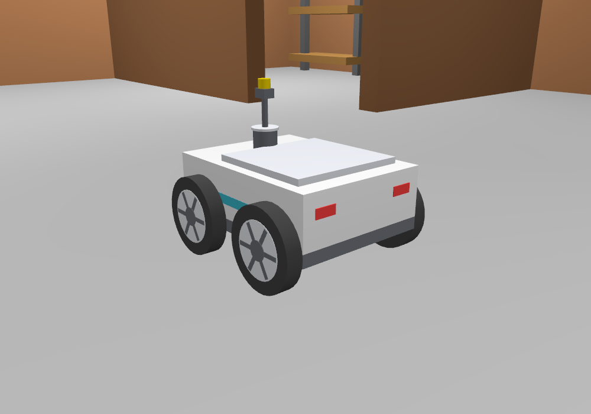

# Delivery Robot: ROS 2 and Gazebo Simulation

A 4-wheel skid-steer delivery robot that maps a simulated warehouse, localizes itself, navigates between rooms and carries out delivery missions. Everything runs in simulation (Gazebo) on ROS 2 Jazzy.

| Front | Rear |
|---|---|
|  |  |

## Features

- **SLAM mapping** with SLAM Toolbox, driven by hand (teleop) or automatically.
- **Automatic exploration** (`nav2_exploration`): finds frontiers in the map and drives to them with Nav2, including into the two rooms through ~0.9 m doorways.
- **Localization** on the saved map with AMCL, and **navigation** with Nav2 (Regulated Pure Pursuit controller, NavFn planner) tuned for tight spaces.
- **Odometry calibration** for the skid-steer base: `wheel_separation_multiplier: 1.28` corrects a ~28% yaw over-report caused by wheel slip, which otherwise makes SLAM drift and produce ghost maps.
- **Multi-stop deliveries** (`deliver`): visit named places in order, wait for confirmation at each, skip unreachable stops, return to the dock.
- **Operator tools**: a Delivery button window, a speed-limit slider, and a route tool to click several stops in RViz.
- **One-command bringup** that starts the whole system in order and waits for each stage to be ready.

## Maps

The warehouse map built by the automatic exploration node (235 x 195 cells, about 11.8 x 9.8 m):


## System overview

Nodes and topics of the running system (generated from the live ROS graph by `docs/make_ros_graph.py`; `/tf`, `/clock`, lifecycle and action topics are hidden for readability):


## Packages

| Package | Purpose |
|---|---|
| `delivery_robot_description` | URDF/Xacro model (robot, lidar, camera, `ros2_control`) and controller config |
| `delivery_robot_gazebo` | Warehouse world, sensor bridges, Gazebo launch files |
| `delivery_robot_teleop` | Keyboard teleop and the `Twist` to `TwistStamped` converter |
| `delivery_robot_navigation` | SLAM, localization, Nav2 config and launch files, RViz view, speed slider, route tool, saved map |
| `delivery_robot_exploration` | `nav2_exploration` (frontier exploration with Nav2) and the older reactive `autonomous_exploration` |
| `delivery_robot_controller` | `deliver` mission command, `delivery_panel` window, named locations |
| `delivery_robot_bringup` | `bringup.launch.py`, the one-command launch |
| `delivery_robot_perception` | Empty for now (planned) |

## Requirements

- Ubuntu 24.04 with ROS 2 Jazzy and Gazebo (`gz sim`)
- ROS packages: Nav2 (`nav2_bringup` and the planner, controller, AMCL, map server and waypoint follower packages), `slam_toolbox`, `ros_gz_sim`, `ros_gz_bridge`, `gz_ros2_control`, `ros2_controllers`, `teleop_twist_keyboard`, `rviz2`
- `python3-tk` (slider and delivery windows), `xterm` (keyboard teleop terminal), `python3-numpy`

## Build

```bash
cd ~/delivery_robot_ws
source /opt/ros/jazzy/setup.bash
colcon build --symlink-install
source install/setup.bash

# The Gazebo launch file reads the controller settings from ~/controllers.yaml
cp src/delivery_robot_description/config/controllers.yaml ~/controllers.yaml
```

## Run

Start everything (Gazebo, localization on the saved map, Nav2, RViz, speed slider, route window, Delivery window):

```bash
ros2 launch delivery_robot_bringup bringup.launch.py
```

Useful arguments: `mode:=slam` (build a new map instead of using the saved one), `rviz:=false`, `speed_slider:=false`, `route_control:=false`, `delivery_panel:=false`, `teleop:=true`.

### Deliveries

- **Delivery window:** click the stops you want (in order), press **Deliver**, then press **Delivered** at each stop once the cargo has been taken. **Cancel** stops the robot.
- **Command line:**

  ```bash
  ros2 run delivery_robot_controller deliver room1 room2 --confirm
  ros2 run delivery_robot_controller deliver --list
  ```

  `--confirm` waits at each stop for Enter or the service `/delivery/confirm`; without it the robot waits `--wait N` seconds. Places are defined in `src/delivery_robot_controller/config/locations.yaml`.

### Clicking several stops in RViz

Pick the **Publish Point** tool once and click stops on the map. Numbered markers appear. Press **Go** in the Route window to drive them in order. **Undo**, **Clear** and **Cancel** are in the same window.

### Mapping

```bash
# Automatic mapping (simulation and SLAM running)
ros2 launch delivery_robot_bringup bringup.launch.py mode:=slam
ros2 run delivery_robot_exploration nav2_exploration --ros-args \
  -p use_sim_time:=true -p map_save_path:=/path/to/my_map
```

Manual mapping works with `teleop:=true`; save the result with `nav2_map_server`'s `map_saver_cli`.

## Status and limitations

- Everything has been tested in simulation only, not on a real robot.
- Mouse clicking in RViz and the layout of the Delivery window are tested by scripted messages and button logic, with limited testing by hand.
- The speed limit affects forward speed only.
- Goals very close to racks can start inside inflated space and need recovery behaviours; "collision ahead" warnings are common in the doorways.
- `gazebo.launch.py` reads `~/controllers.yaml` (see Build). If you edit `controllers.yaml` in the package, copy it there again.

## Roadmap

- Visual SLAM with an RGB-D camera (RTAB-Map) and a comparison with LiDAR SLAM
- Camera-based cargo detection (perception package)
- Order queue, battery and docking
- Automatic slowing near doorways
- Automated launch tests
- A real-robot version
